<p align="center"></p>

# RoCer0

**Roblox a tu medida.** RoCer0 es una extensión para Firefox, Zen, Chrome, Brave, Edge y Opera que cambia el aspecto de roblox.com y le añade decenas de herramientas. Cada función tiene su interruptor y sus opciones, así que puedes dejar solo lo que te guste.


<sub>Las capturas están hechas con datos de ejemplo.</sub>

- **Versión:** 1.2.0
- **Navegadores:** Firefox 121 o posterior y los basados en Firefox (Zen, LibreWolf, Floorp, Waterfox), y Chrome, Brave, Edge y Opera (basados en Chromium 111 o posterior).
- **Sin servidores propios:** todo lo que guarda se queda en tu navegador.

## Índice

1. [Instalación](#instalación)
2. [Qué hace RoCer0](#qué-hace-rocer0)
3. [Los ajustes](#los-ajustes)
4. [Atajos de teclado](#atajos-de-teclado)
5. [Privacidad y permisos](#privacidad-y-permisos)
6. [Límites conocidos](#límites-conocidos)
7. [Para desarrolladores](#para-desarrolladores)

## Instalación

Descarga el zip de tu navegador (están en la carpeta [`descargas/`](descargas)):

| Navegador | Descarga |
|---|---|
| Chrome, Brave, Edge y Opera | [rocer0-chromium-1.2.0.zip](https://github.com/marieteffk/RoCer0/raw/main/descargas/rocer0-chromium-1.2.0.zip) |
| Firefox, Zen, LibreWolf, Floorp y Waterfox | [rocer0-firefox-1.2.0.zip](https://github.com/marieteffk/RoCer0/raw/main/descargas/rocer0-firefox-1.2.0.zip) |

### Chrome, Brave, Edge y Opera

1. Descomprime `rocer0-chromium-1.2.0.zip` en una carpeta que no vayas a borrar.
2. Abre la página de extensiones de tu navegador:
   - Chrome: `chrome://extensions`
   - Brave: `brave://extensions`
   - Edge: `edge://extensions`
   - Opera: `opera://extensions`
3. Activa el **modo de desarrollador** (en Edge está en el menú de la izquierda).
4. Pulsa **Cargar descomprimida** (en Opera, **Cargar desempaquetada**) y elige la carpeta del paso 1.
5. Entra en roblox.com y recarga la página.

La extensión se queda instalada aunque cierres el navegador. Si algún día lo pide, vuelve a pulsar **Recargar** en su tarjeta.

### Firefox, Zen, LibreWolf, Floorp y Waterfox

Zen, LibreWolf, Floorp y Waterfox son Firefox por dentro: usan el zip de Firefox, no el de Chrome.

1. Abre `about:debugging#/runtime/this-firefox`.
2. Pulsa **Cargar complemento temporal…** y elige `rocer0-firefox-1.2.0.zip`.
3. Se abre la página de ajustes. Si sale el aviso amarillo de permisos, pulsa **Dar permiso**.
4. Entra en roblox.com y recarga la página.

Si al cargarlo sale «background.service_worker is currently disabled. Add background.scripts.», has elegido el zip de Chrome: usa el de Firefox.

Firefox quita los complementos temporales al cerrarse. Para tenerlo siempre hay que firmarlo en [addons.mozilla.org](https://addons.mozilla.org/developers/) (se puede firmar sin publicarlo) o usar Firefox Developer Edition o Nightly con `xpinstall.signatures.required` en `false` dentro de `about:config`.

### Actualizar

Descarga la versión nueva y repite los pasos. Tus ajustes, temas, fijados y notas se conservan mientras no quites la extensión. Antes de quitarla, puedes guardar una copia en **Ajustes → Permisos y datos → Exportar ajustes**.

### Novedades de la 1.2

- **Tema Pablo**, eléctrico y a toda velocidad: noche violeta, rayos cian y verde ácido, estelas que cruzan la pantalla con el nombre de la sección al cambiar de página, títulos con ecos que se quedan atrás, el menú lateral como una lista de salida con dorsales y chispas al hacer clic. También cambia los ajustes y el popup.
- **Es un tema fijo, como Daniel:** mientras está puesto no vale ninguna personalización. Lo que tengas guardado no se borra y vuelve en cuanto eliges otro tema.
- **Papelera de amigos.** En tu página de Amigos sale un botón con una papelera pegado al borde derecho. Al pulsarlo entras en el modo borrar: eliges amigos con un clic, de uno en uno, o manteniendo pulsado el ratón y arrastrando para coger a varios. **Eliminar** te enseña la lista y solo se eliminan si lo confirmas. Va poco a poco para que Roblox no la frene y se apaga en **Ajustes → Papelera de amigos**.
- **Daniel y Pablo también visten la papelera.**

### Novedades de la 1.1.2

Daniel, otra vez a partir de lo que se veía en el Roblox de verdad:

- **El menú lateral cambia esté hecho como esté.** Daniel lo reconoce por sus enlaces (Inicio, Perfil, Mensajes, Amigos…) y no por sus clases ni por si usa listas, así que sirve para el menú de 2026 y para los que vengan. También cubre la tienda oficial, que ahora es un botón sin enlace, el recuadro nuevo de Roblox Plus y las cajas con fondo propio que tapaban el panel negro.
- **Amigos con el estilo de Daniel.** El carrusel de amigos de Roblox (en los perfiles y en el Inicio de Roblox, si lo enseñas), la página de amigos y cualquier lista de gente: caras en marcos cuadrados blancos y girados, nombres en negrita inclinada, la línea de debajo en rojo, tarjetas como hojas negras con sombra roja y el desplegable de cada amigo como los demás menús. Los amigos en común de los perfiles llevan el mismo marco. Nada cambia de sitio ni de tamaño.
- **Probado en Zen.** Además de en Chrome, las pruebas de Daniel pasan ahora en Zen (el motor de Firefox), con una copia de roblox.com que pide la sesión y el token como la de verdad.
- **Diagnóstico más completo.** Dice si tus amigos cargan (y, si no, qué respondió Roblox) y qué listas de gente ha encontrado Daniel.

### Novedades de la 1.1.1

Arreglos de Daniel a partir de una captura del Roblox de verdad:

- **Daniel en el menú lateral nuevo de Roblox.** Solo conocía el menú antiguo. Ahora reconoce el nuevo (y, si Roblox le cambia el nombre, lo encuentra por sus enlaces): letras recortadas en cada entrada, con más hueco entre palabras, el rayo en la página en la que estás, sin iconos, los contadores en una etiqueta roja, tu nombre en una placa negra y el recuadro de Roblox Plus como una hoja negra.
- **El Inicio de RoCer0 vuelve a salir.** Roblox pinta su Inicio en dos tiempos y, al terminar de cargar, vacía esa zona y se llevaba el de RoCer0. Ahora se vuelve a poner antes de que se llegue a ver, sale también si llegas al Inicio sin recargar, y el de Roblox sigue oculto aunque lo rehaga. Si aun así no puede, lo dice y deja reintentar.
- **Daniel va ligero.** Las estrellas del fondo giraban sin parar y obligaban a repintar toda la pantalla en cada fotograma. Ahora están quietas y dan una vuelta corta al entrar en cada página: con la página quieta, el navegador trabaja unas 8 veces menos.
- **El ping del contador vuelve a medirse.**
- **Contenedores y ventanas privadas.** Si la pestaña tiene una sesión que la extensión no ve (contenedores de Firefox, ventana privada), el Inicio usa la cuenta de esa pestaña y pide los datos a Roblox desde la propia página.
- **Copiar diagnóstico.** Botón nuevo arriba en el popup: copia un resumen de cómo está hecha la página de Roblox abierta (etiquetas, clases y tamaños, sin nombres, textos ni números) para pegarlo al avisar de algo que se ve mal. No se envía a ningún sitio.

### Novedades de la 1.1

- **Tema Daniel**, al estilo de los menús de Persona 5: rojo, negro y blanco, estrellas detrás de todo, el menú lateral convertido en un menú de comandos con rayos azules, títulos con letras recortadas como una nota de rescate, una cortina al cambiar de página y un golpe rojo y negro al hacer clic. También cambia los ajustes y el popup.
- **Es un tema fijo:** mientras está puesto no vale ninguna personalización. Lo que tengas guardado no se borra y vuelve en cuanto eliges otro tema.

### Novedades de la 1.0.1

- **El Inicio ocupa toda la pantalla en el PC.** En la web nueva de Roblox, el Inicio de RoCer0 se quedaba en una columna estrecha en el centro, como en el móvil. Ahora llena todo el hueco al lado del menú, y si la ventana es estrecha, las tarjetas se ponen una debajo de otra.
- **Logo nuevo:** el cero plateado sobre fondo negro, en el icono de la extensión, la barra del navegador, los ajustes, el popup, la pestaña de RoCer0 dentro de Roblox y el Wrapped.

### Novedades de la 1.0

- **Ajustes por secciones:** un menú lateral con 30 secciones en 7 grupos y un buscador que encuentra cualquier opción.
- **Todo se puede configurar:** cada función tiene su sección con un interruptor general, sus opciones y un botón para restablecerla.
- **Menos ruido visual:** opciones agrupadas que solo aparecen cuando hacen falta, y densidad cómoda o compacta.
- **Inicio y popup a tu gusto:** qué tarjetas salen, su orden, el diseño y las opciones de cada una.
- **Chrome, Brave, Edge y Opera**, además de Firefox.

## Qué hace RoCer0

Las funciones están agrupadas igual que en el menú de los ajustes.

### Apariencia

**Temas.** 29 temas inspirados en los de BetterDiscord: oscuros, claros, transparentes, animados, neón, pastel, de espacio, de naturaleza y dos de temporada (Halloween y Navidad, que se ponen solos en sus fechas). Dos de ellos son fijos: Daniel, al estilo de Persona 5, y Pablo, eléctrico y a toda velocidad. Un tema no cambia solo los colores, también la forma de la web. El editor deja tocarlo todo y se ve al momento en una vista previa:

- **Colores:** el acento y los 10 colores del tema por separado.
- **Fondo:** color, degradado propio de hasta 6 colores, 25 fondos dibujados, una imagen o varias que van cambiando, o un vídeo de tu PC. Tiene filtros (desenfoque, brillo, contraste, saturación…), capas por encima (viñeta, tinte, líneas de monitor…) y 10 tipos de partículas como nieve, estrellas o pétalos.
- **Estructura:** 18 piezas de la web, como la barra de arriba, el menú lateral, el ancho, los paneles, las tarjetas, los botones, los títulos, los avatares, el cursor o la barra de desplazamiento.
- **Letra y efectos:** transparencia y desenfoque de los paneles, esquinas, sombras, brillo neón y 11 tipos de letra.
- **Tema automático:** uno de día y otro de noche a las horas que elijas.
- **Guardar, exportar e importar** temas propios en un archivo `.json`.

| | |
|---|---|
|  |  |
| Vídeo de tu PC de fondo, nieve y el menú lateral solo con iconos | Una imagen de tu PC de fondo con el tema Sakura |

**Daniel, tema fijo.** Está inspirado en los menús de Persona 5 y cambia toda la web:

- **Colores y fondo:** rojo, negro y blanco planos, con un panel rojo cortado en diagonal y estrellas de cinco puntas detrás de todo, que dan una vuelta corta al entrar en cada página.
- **Letras recortadas:** los títulos y el menú lateral se escriben como una nota de rescate, cada letra con su recorte, su tipo de letra y su inclinación. El texto de verdad sigue ahí para los lectores de pantalla.
- **Menú de comandos:** al pasar el ratón por el menú lateral salta un rayo azul con una punta roja, y la página en la que estás queda marcada.
- **Amigos:** en el carrusel de amigos, la página de amigos y cualquier lista de gente, cada cara va en un marco cuadrado blanco y girado, los nombres en negrita inclinada y las tarjetas como hojas negras con sombra roja.
- **Animaciones:** las tarjetas entran de golpe al abrir una página, una cortina roja y negra cruza la pantalla al cambiar de página y cada clic en un botón deja un golpe rojo y negro. Si tu sistema pide reducir el movimiento, no hay animaciones y se quedan las letras recortadas.
- **Ajustes y popup** con el mismo estilo.

Es un **tema fijo**: mientras está puesto no vale ninguna personalización. Ni colores, ni fondo, ni letra, ni iconos, ni estructura, ni los retoques de Interfaz, ni el tamaño del popup, y el tema automático tampoco. En los ajustes esas opciones salen con un candado. Lo que tengas guardado no se borra: vuelve en cuanto eliges otro tema en la galería. Las funciones y las tarjetas del Inicio se siguen eligiendo como siempre.

| | |
|---|---|
| 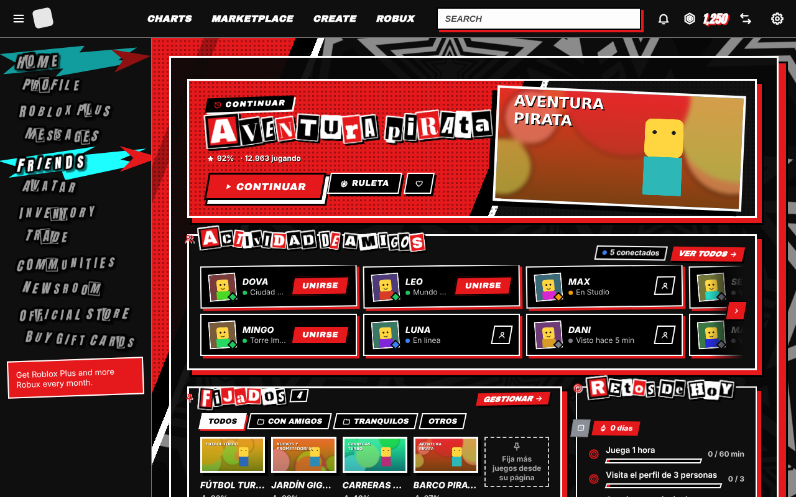 | 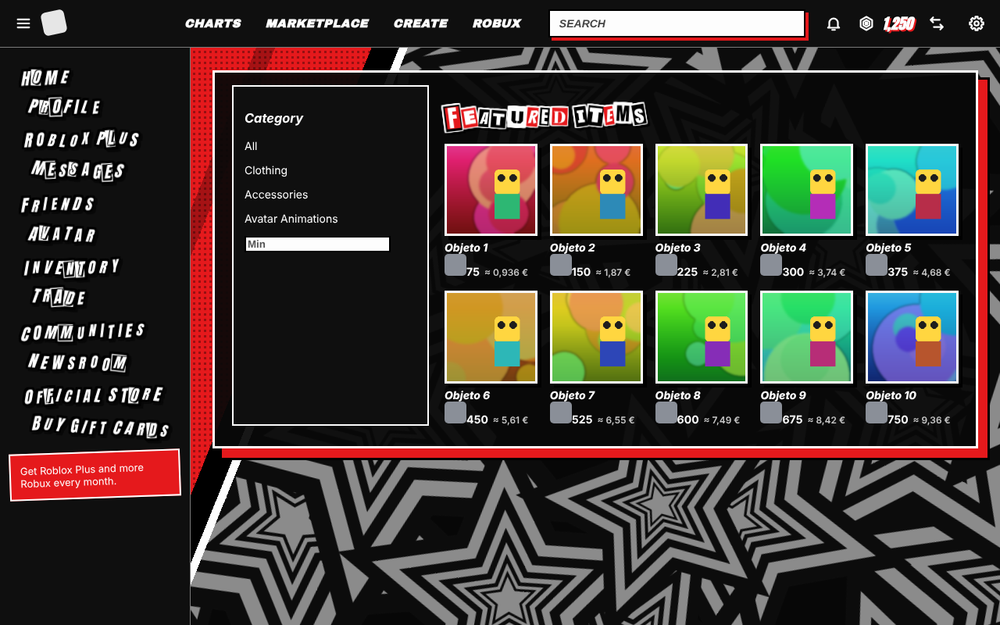 |
| El Inicio con Daniel, con el ratón sobre una entrada del menú | El catálogo con Daniel |
| 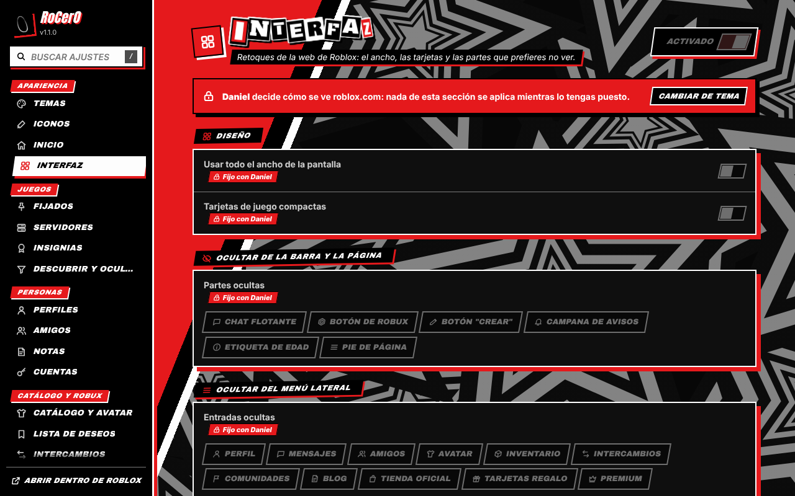 | 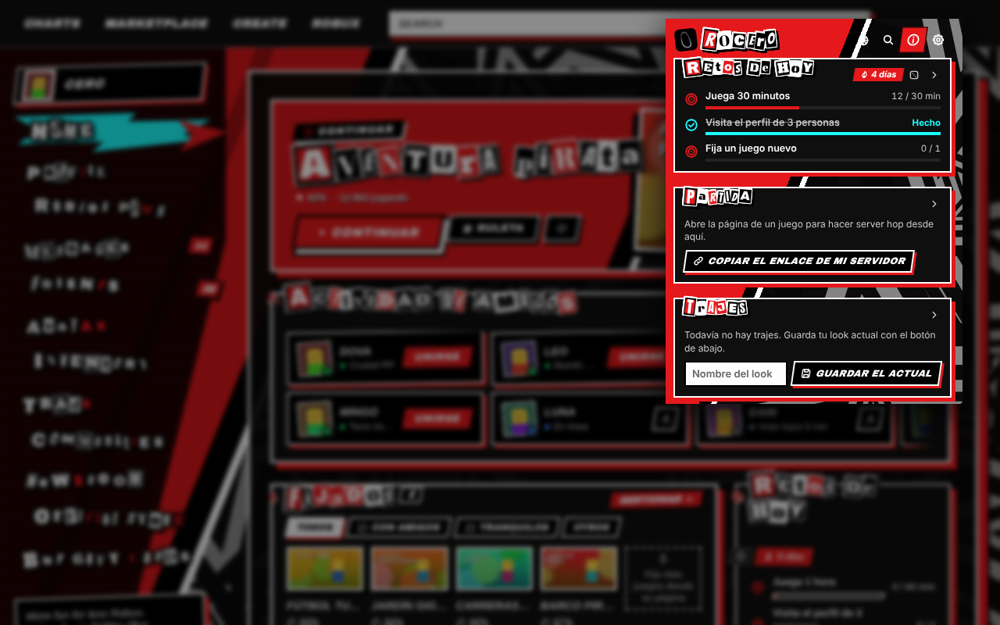 |
| Los ajustes con Daniel: lo que no se puede tocar lleva un candado | El popup con Daniel |
| 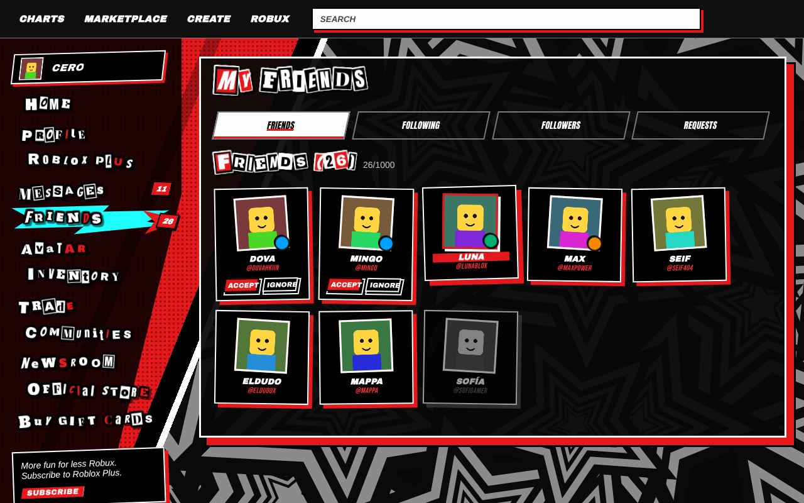 | 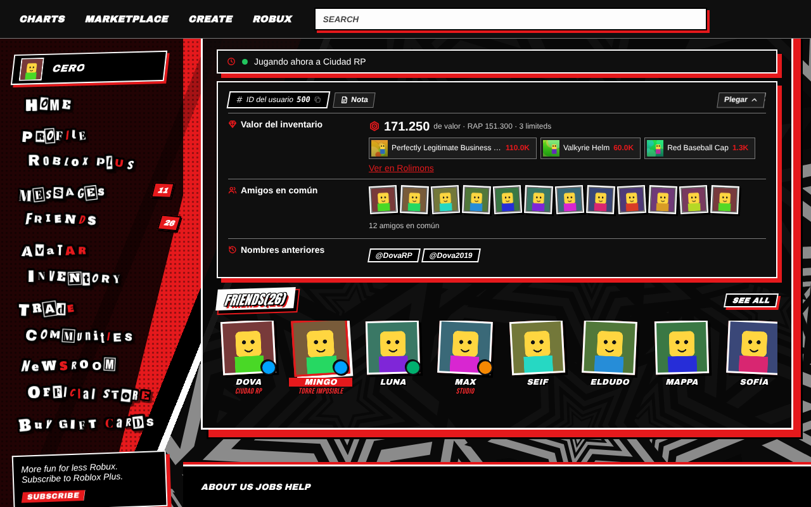 |
| La página de amigos con Daniel | Un perfil con Daniel: sus amigos y los amigos en común |

<sub>Daniel está dibujado entero para RoCer0: no usa imágenes, logos, sonidos ni tipos de letra de los juegos de Persona, y RoCer0 no tiene ninguna relación con ATLUS ni con SEGA. Sus letras son fuentes libres (SIL Open Font License) recortadas y con otro nombre; las licencias están en [`extension/fonts/LICENCIAS.txt`](extension/fonts/LICENCIAS.txt).</sub>

**Pablo, tema fijo.** Es eléctrico, va a toda velocidad y también cambia toda la web:

- **Colores y fondo:** noche violeta e índigo con brillos suaves, líneas de pista y rayos quietos, y dos colores de energía, cian eléctrico y verde ácido. Las piezas llevan esquinas cortadas, líneas finas y etiquetas pequeñas tipo «// 01».
- **La palabra de cada sección:** Inicio, Amigos, Perfil, Tienda… en letras enormes y huecas al fondo de la página.
- **Menú de carrera:** cada entrada del menú lateral lleva su dorsal (01, 02…) en lugar del icono y se adelanta con un subrayado eléctrico al pasar el ratón. La página en la que estás va en un paralelogramo de energía con una chispa que corre debajo.
- **Títulos con eco:** dos copias, una cian y otra verde, llegan desde atrás y se apagan.
- **Amigos:** caras en marcos cuadrados cian, que se ponen verdes al pasar el ratón, nombres en letra de etiqueta, el estado en números de cronómetro y tarjetas como paneles con una franja de energía.
- **Animaciones:** al entrar en una página o cambiar de página cruzan la pantalla unas estelas de velocidad con el nombre de la sección, las tarjetas del Inicio llegan desde la izquierda, las ventanas entran deprisa y frenan, y cada clic suelta ocho chispas. Si tu sistema pide reducir el movimiento, no hay estelas, chispas ni ecos, y se quedan los colores y las formas.
- **Ajustes, popup y papelera** con el mismo estilo.

Como Daniel, es un **tema fijo**: mientras está puesto no vale ninguna personalización y esas opciones salen con candado en los ajustes. Lo que tengas guardado vuelve en cuanto eliges otro tema.

| | |
|---|---|
| 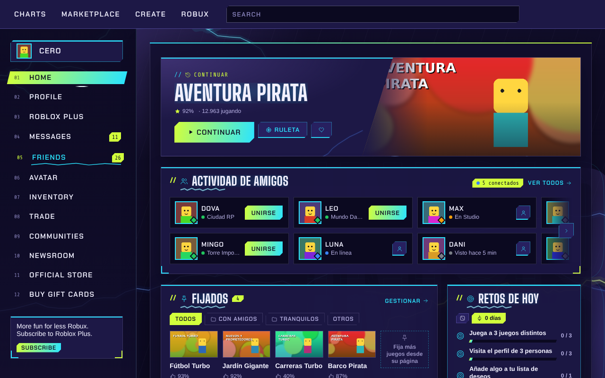 | 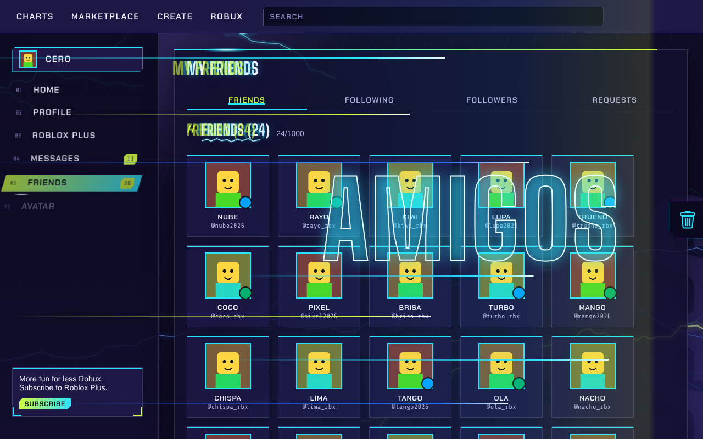 |
| El Inicio con Pablo, con el ratón sobre una entrada del menú | Al cambiar de página: las estelas con el nombre de la sección |
| 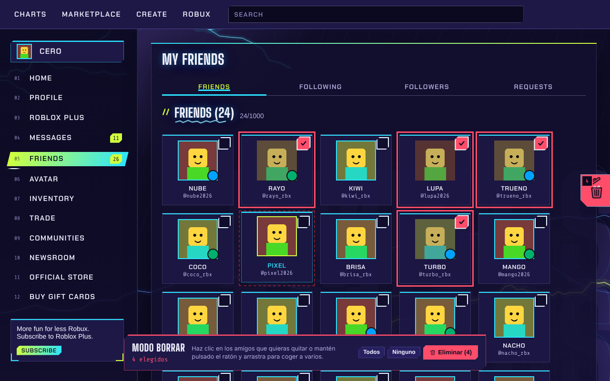 | 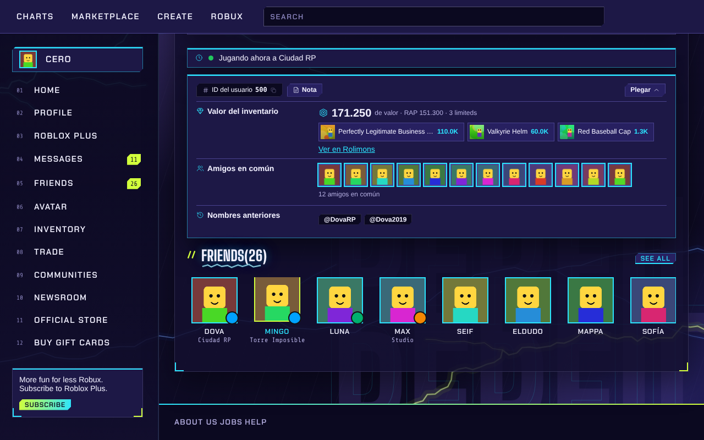 |
| La página de amigos con Pablo, en el modo borrar | Un perfil con Pablo |
| 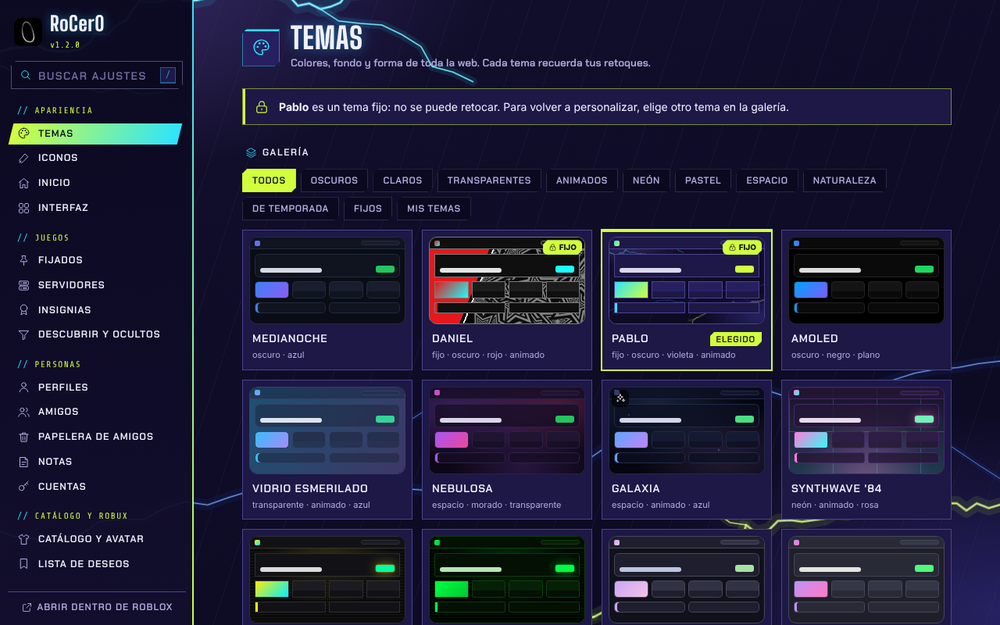 | 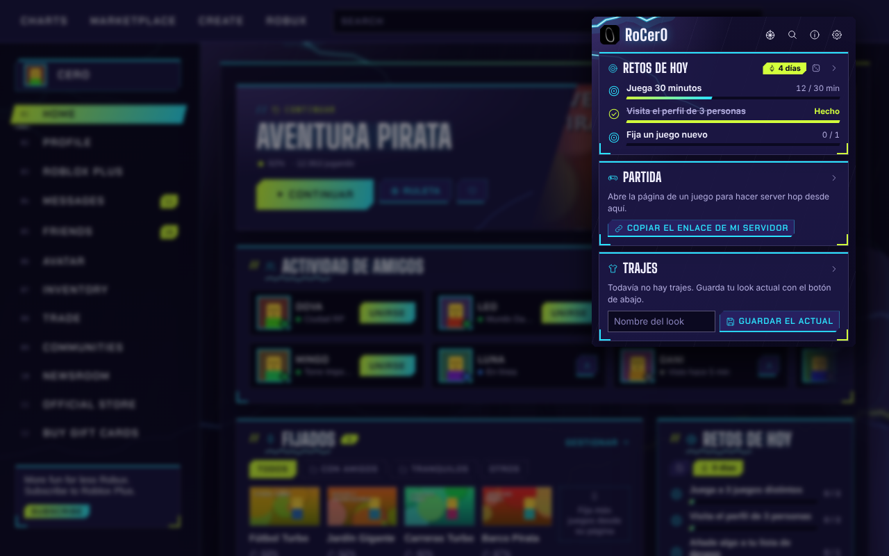 |
| Los ajustes con Pablo | El popup con Pablo |

<sub>Pablo también está dibujado entero para RoCer0, con formas, colores y animaciones propias. Sus letras son fuentes libres (SIL Open Font License) recortadas y con otro nombre; las licencias están en el mismo archivo.</sub>

**Iconos.** Más de cien iconos dibujados para RoCer0, sin emojis. Puedes cambiar su trazo, tamaño y color, y cambiar cualquiera (también los de la barra y el menú de Roblox) por una imagen de tu PC.

**Inicio.** Cambia el Inicio de Roblox por un panel de tarjetas que eliges y ordenas arrastrando: banner "Continuar" con el último juego, actividad de amigos con botón para unirte, juegos fijados, retos de hoy, continuar, juegos recientes con tu tiempo, recomendación destacada, recomendados y colecciones. Se colocan en mosaico, en dos columnas o una por fila, y cada tarjeta tiene sus opciones (cuántos amigos o juegos, el orden, el periodo de "recientes"…).

**Interfaz.** Usar todo el ancho de la pantalla, tarjetas de juego compactas, esconder partes de la web (chat flotante, botón de Robux, "Crear", campana, etiqueta de edad, pie de página) y entradas del menú lateral, y añadir tu propio CSS.

### Juegos

**Fijados.** Tus juegos a mano en el Inicio, el popup y PowerSearch, con carpetas y orden manual, por nombre o por los que jugaste hace menos. Se fija con un botón en la página de cada juego.

**Servidores.** Un panel en la página de cada juego para buscar servidores con filtros (huecos libres, ping, orden), ver la región de cada uno, copiar el enlace de un servidor para que un amigo entre en el mismo, ir a uno al azar, hacer server hop sin repetir los últimos y hacer auto-hop cada cierto tiempo.

**Insignias.** Una tabla compacta con la rareza de cada insignia del juego y las que ya tienes, con orden, columnas y la opción de esconder las conseguidas.

**Descubrir y ocultos.** Filtra las listas de juegos por valoración mínima o por palabras, oculta un juego o todos los de un creador con un botón, y quita los juegos patrocinados y los anuncios. Desde los ajustes puedes volver a mostrar lo que ocultaste.

### Personas

**Perfiles.** En el perfil de cada persona: valor de su inventario y sus objetos más valiosos (si es público), amigos en común, nombres anteriores y cuándo se conectó por última vez.

**Amigos.** Registra a qué juegan tus amigos para el Inicio, las estadísticas y el Wrapped, y te deja marcar amigos favoritos para los avisos.

**Papelera de amigos.** Un botón con una papelera en el borde derecho de tu página de Amigos activa el modo borrar. Solo sale en tu propia lista, nunca en la de otra persona ni en las solicitudes.

- Eliges a quién quitar con un clic, de uno en uno, o manteniendo pulsado el ratón y arrastrando para coger a varios. Con Mayús coges todos los que hay entre dos, y **Todos** y **Ninguno** eligen o sueltan la página entera. Lo que eliges se guarda aunque pases de página en la lista.
- **Eliminar** te enseña la lista de elegidos y avisa de que no se puede deshacer: solo se eliminan si lo confirmas. Esc o la propia papelera salen sin borrar nada.
- Va sin prisa para que Roblox no la frene: los 8 primeros seguidos y luego uno cada pocos segundos. Si Roblox pide esperar, espera, y si quiere comprobar que eres tú, se para y los deja elegidos.

| | |
|---|---|
| 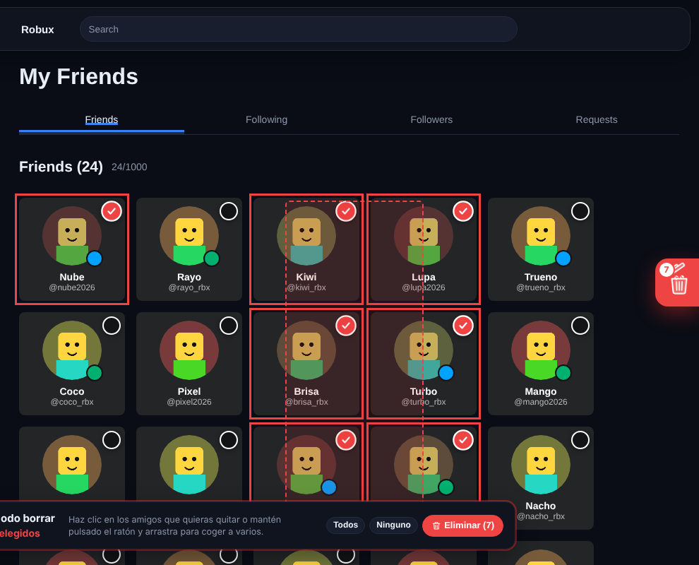 | 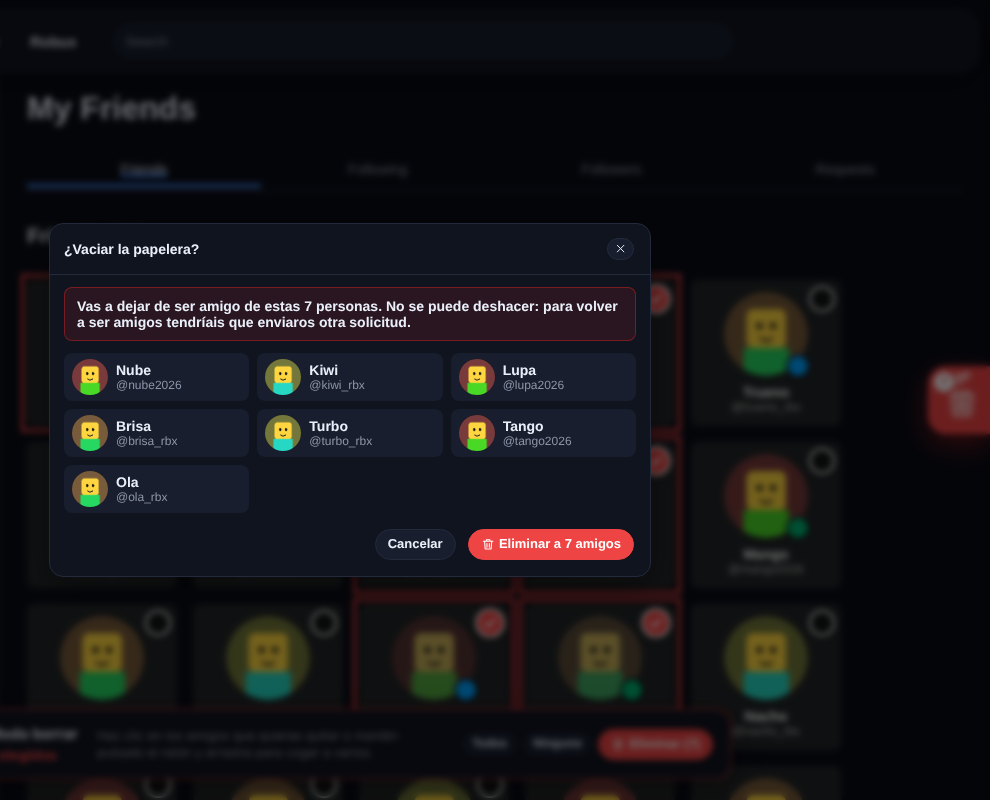 |
| El modo borrar, arrastrando para elegir a varios | Antes de eliminar, hay que confirmarlo |

**Notas.** Notas y etiquetas personales en juegos y perfiles, que solo ves tú. En los ajustes están todas juntas, con buscador y filtro por etiqueta.

**Cuentas.** Guarda tus cuentas de Roblox y cambia entre ellas con un clic desde la barra de Roblox, el popup o los ajustes.

### Catálogo y Robux

**Catálogo y avatar.** Vista previa rápida de cada objeto del catálogo (y probártelo), botones de herramientas en cada objeto (explorador, contenido, descarga y propietarios), valor y enlace de Rolimons en los limitados, equipar accesorios sin el límite del editor de avatar y un cambiador rápido de trajes en el popup.

**Lista de deseos.** Sigue el precio de los objetos que quieras y recibe un aviso cuando bajan, cuando llegan al precio que pusiste o cuando vuelven a estar a la venta.

**Intercambios.** Valor de Rolimons sobre cada objeto en tus intercambios, calculadora (descuenta el 30 % que se queda Roblox de los Robux que recibes) y avisos de los trades que te llegan, con lo que ganas o pierdes.

**Robux y dinero.** El precio en dinero real junto a los Robux, en cualquiera de 153 monedas o en una propia, con el precio de compra o el de DevEx, y el formato que prefieras.

### Tu actividad

**Retos.** De 1 a 5 retos al día de 12 tipos (jugar un rato, varios juegos, unirte a un amigo, visitar perfiles, probar un juego nuevo…), con tres dificultades, rachas, cuatro medallas y un calendario de las últimas semanas. Puedes cambiar los retos una vez al día.

**Wrapped.** El resumen de tu mes en Roblox: tiempo jugado, juegos, días, insignias, retos, con quién más jugaste y tus juegos del mes. Incluye una tarjeta para compartir en formato horizontal, cuadrado o de historia, con los colores de tu tema o los que elijas. Se descarga o se copia como imagen.

**Estadísticas.** Tu tiempo en roblox.com por día, un gráfico de tu saldo de Robux, tu tiempo en cada juego, a qué juegan tus amigos y su última conexión. Tú eliges qué se registra y qué periodo enseña cada gráfico.

**Descansos.** Un recordatorio para descansar tras un rato jugando y un límite de juego al día, con aviso del sistema y también dentro de roblox.com.

**Ruleta y confeti.** Una ruleta que elige a qué jugar entre tus fijados, tus recientes o los recomendados, y confeti cuando consigues una insignia, completas los retos, ganas una medalla o haces un buen trade.

### Herramientas

**PowerSearch.** Un buscador rápido de tus fijados, juegos, personas, objetos y grupos que se abre con `Ctrl+K` en cualquier página de Roblox, con botón para jugar y búsquedas recientes.

**Copiar IDs.** Botones para copiar el ID o el enlace de juegos, objetos, personas, grupos e insignias.

**Modo streamer.** Oculta tu nombre, tu avatar, tus Robux, los nombres de tus amigos y el chat mientras haces directo, con un atajo para encenderlo y apagarlo.

**FPS y ping.** Un contador de FPS de la web y del ping hacia Roblox, con posición, tamaño y colores a tu gusto.

**Detector de plugins.** Revisa los plugins y modelos de la tienda de creadores y avisa de señales típicas de malware, como `require()` ocultos, `getfenv` o `loadstring`.

### RoCer0

**Notificaciones.** Todos los avisos en un sitio: amigos que se conectan o entran a un juego (todos o solo los favoritos), insignias, y un horario de silencio.

**Popup.** El panel que se abre con el botón de RoCer0 en la barra del navegador: retos, tu partida y server hop, trajes, fijados, tema, interruptores rápidos, cuentas y accesos directos. Eliges qué tarjetas salen, en qué orden y su tamaño.

**General, permisos y datos.** Cómo se abren los ajustes, cada cuánto se consulta a Roblox, los permisos, la copia de seguridad y el borrado de lo que guarda RoCer0.

## Los ajustes


- Están **dentro de Roblox**: en roblox.com, ve a **Ajustes → RoCer0** o a la rueda dentada → **RoCer0**. También se abren como página aparte desde el popup.
- Un **menú lateral** con las 31 secciones, agrupadas como en este texto.
- Un **buscador** que encuentra cualquier opción por su nombre (pulsa `/`). Las opciones se pueden cambiar desde los propios resultados.
- Cada sección tiene un **interruptor general** arriba y un botón para **restablecerla**.
- Densidad cómoda o compacta, y abrir en la última sección que usaste o en la que elijas.


| | |
|---|---|
|  |  |
|  |  |

## Atajos de teclado

| Atajo | Qué hace |
|---|---|
| `Ctrl+K` | Abre PowerSearch en roblox.com (se puede cambiar) |
| `Alt+Shift+R` | Abre el popup de RoCer0 |
| `/` | Busca en los ajustes |
| El que elijas | Enciende y apaga el modo streamer |

## Privacidad y permisos

- RoCer0 **no tiene servidor propio** y no manda datos tuyos a nadie.
- Solo habla con:
  - **Roblox**, para todo lo que muestra;
  - **Rolimons**, para los valores de los objetos limitados;
  - **ipinfo.io**, solo con la IP de los servidores de juego, para saber su región (se puede apagar);
  - **open.er-api.com**, para los tipos de cambio de moneda.
- Las sesiones de las cuentas guardadas se quedan solo en el almacenamiento local de la extensión y solo se envían a roblox.com.
- La papelera de amigos solo pide a Roblox que quite a los amigos que elegiste, y solo después de que lo confirmes.
- El diagnóstico del popup no sale de tu ordenador: solo se copia al portapapeles, y no lleva nombres, textos ni números.
- Permisos que pide:
  - **almacenamiento**, para tus ajustes y datos;
  - **alarmas**, para las consultas periódicas;
  - **notificaciones**, para los avisos;
  - **cookies**, solo para cambiar de cuenta;
  - **acceso a esas cuatro webs**.

## Límites conocidos

- **Roblox cambia su web a menudo.** Si cambia algo, una función puede dejar de verse hasta que se actualice RoCer0. El botón **Copiar diagnóstico** del popup ayuda a arreglarlo sin compartir tus datos.
- **Los FPS dentro del juego** los mide el cliente de Roblox (`Shift+F5`). RoCer0 muestra los FPS de la web y el ping hacia Roblox.
- **Server hop:** la extensión no puede cerrar el juego. Abre la entrada al servidor nuevo y Roblox cierra la partida anterior.
- **Región del servidor:** Roblox no la publica. Se calcula localizando la IP del servidor.
- **Última conexión:** Roblox ya no la enseña. RoCer0 la reconstruye con lo que ve desde que lo instalaste.
- **Estadísticas, Wrapped y retos** empiezan vacíos y se llenan mientras el navegador está abierto.
- **Vídeo de fondo:** hasta 30 MB, sin sonido y en bucle.
- **Papelera de amigos:** Roblox no deja quitar muchos amigos seguidos, así que con muchos va poco a poco (unos 9 por minuto después de los 8 primeros).

## Para desarrolladores

RoCer0 está hecha en JavaScript sin dependencias ni paso de compilación. El código está en [`extension/`](extension):

| Carpeta | Qué contiene |
|---|---|
| `manifest.json` | Manifest V3 que sirve para Firefox y para Chromium |
| `background.js` | Consultas periódicas, avisos, retos, cuentas y lista de deseos |
| `common/` | Ajustes por defecto y sus secciones (`defaults.js`), temas, iconos, fondos animados y confeti |
| `content/` | Lo que se añade a roblox.com: Inicio, temas, PowerSearch, servidores, perfiles, catálogo… |
| `options/` | La página de ajustes, que se genera a partir de las secciones de `defaults.js` |
| `popup/` | El panel del botón de la barra |
| `page/` | Piezas que se cargan dentro de Roblox (vídeo de fondo y lanzador de juegos) |
| `fonts/` | Las letras de los temas Daniel y Pablo, fuentes libres con sus licencias en `LICENCIAS.txt` |

Para probarla sin empaquetar, carga la carpeta `extension/` como extensión descomprimida en Chromium o su `manifest.json` como complemento temporal en Firefox.

Para crear los dos zips (Firefox y Chromium) hace falta Node.js y el comando `zip`:

```sh
node herramientas/empaquetar.mjs extension dist
```

`content/layout.css`, la estructura que cambian los temas, se genera con Python a partir de las listas de selectores de `herramientas/estructura.py`:

```sh
python3 herramientas/estructura.py extension/content/layout.css
```

Los iconos de la extensión (`icons/icon-16.png` a `icon-128.png`) y el logo grande (`icons/logo.png`) salen del logo original, [`herramientas/logo-original.png`](herramientas/logo-original.png). Para rehacerlos hace falta Python con Pillow y NumPy:

```sh
python3 herramientas/logo.py herramientas/logo-original.png extension/icons
```
