<p align="center">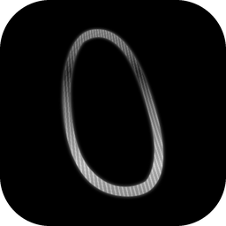</p>

# RoCer0

**Roblox a tu medida.** RoCer0 es una extensión para Firefox, Chrome, Brave, Edge y Opera que cambia el aspecto de roblox.com y le añade decenas de herramientas. Cada función tiene su interruptor y sus opciones, así que puedes dejar solo lo que te guste.

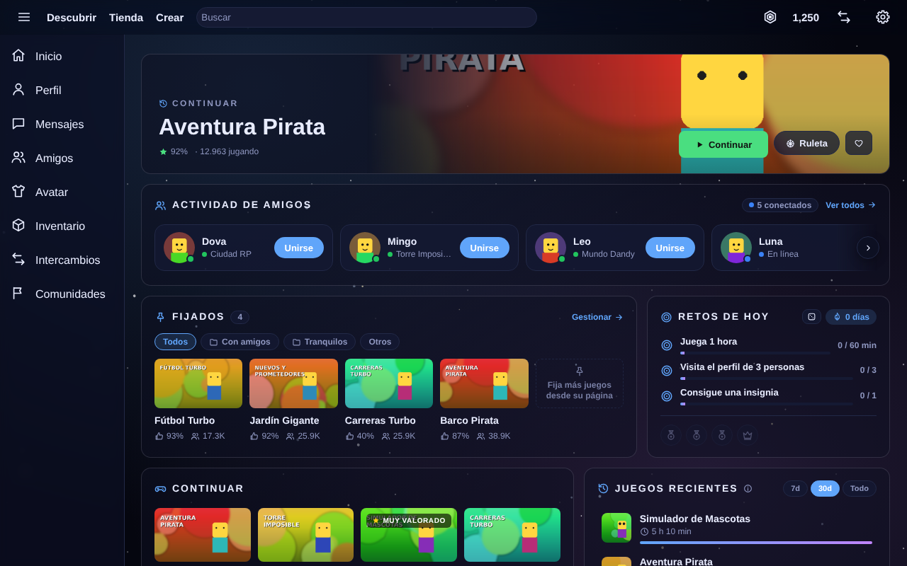

<sub>Las capturas están hechas con datos de ejemplo.</sub>

- **Versión:** 1.0.1
- **Navegadores:** Firefox 121 o posterior, y Chrome, Brave, Edge y Opera (basados en Chromium 111 o posterior).
- **Sin servidores propios:** todo lo que guarda se queda en tu navegador.

## Índice

1. [Instalación](#instalación)
2. [Qué hace RoCer0](#qué-hace-rocer0)
3. [Los ajustes](#los-ajustes)
4. [Atajos de teclado](#atajos-de-teclado)
5. [Privacidad y permisos](#privacidad-y-permisos)
6. [Límites conocidos](#límites-conocidos)
7. [Para desarrolladores](#para-desarrolladores)

## Instalación

Descarga el zip de tu navegador (están en la carpeta [`descargas/`](descargas)):

| Navegador | Descarga |
|---|---|
| Chrome, Brave, Edge y Opera | [rocer0-chromium-1.0.1.zip](https://github.com/marieteffk/RoCer0/raw/main/descargas/rocer0-chromium-1.0.1.zip) |
| Firefox | [rocer0-firefox-1.0.1.zip](https://github.com/marieteffk/RoCer0/raw/main/descargas/rocer0-firefox-1.0.1.zip) |

### Chrome, Brave, Edge y Opera

1. Descomprime `rocer0-chromium-1.0.1.zip` en una carpeta que no vayas a borrar.
2. Abre la página de extensiones de tu navegador:
   - Chrome: `chrome://extensions`
   - Brave: `brave://extensions`
   - Edge: `edge://extensions`
   - Opera: `opera://extensions`
3. Activa el **modo de desarrollador** (en Edge está en el menú de la izquierda).
4. Pulsa **Cargar descomprimida** (en Opera, **Cargar desempaquetada**) y elige la carpeta del paso 1.
5. Entra en roblox.com y recarga la página.

La extensión se queda instalada aunque cierres el navegador. Si algún día lo pide, vuelve a pulsar **Recargar** en su tarjeta.

### Firefox

1. Abre `about:debugging#/runtime/this-firefox`.
2. Pulsa **Cargar complemento temporal…** y elige `rocer0-firefox-1.0.1.zip`.
3. Se abre la página de ajustes. Si sale el aviso amarillo de permisos, pulsa **Dar permiso**.
4. Entra en roblox.com y recarga la página.

Firefox quita los complementos temporales al cerrarse. Para tenerlo siempre hay que firmarlo en [addons.mozilla.org](https://addons.mozilla.org/developers/) (se puede firmar sin publicarlo) o usar Firefox Developer Edition o Nightly con `xpinstall.signatures.required` en `false` dentro de `about:config`.

### Actualizar

Descarga la versión nueva y repite los pasos. Tus ajustes, temas, fijados y notas se conservan mientras no quites la extensión. Antes de quitarla, puedes guardar una copia en **Ajustes → Permisos y datos → Exportar ajustes**.

### Novedades de la 1.0.1

- **El Inicio ocupa toda la pantalla en el PC.** En la web nueva de Roblox, el Inicio de RoCer0 se quedaba en una columna estrecha en el centro, como en el móvil. Ahora llena todo el hueco al lado del menú, y si la ventana es estrecha, las tarjetas se ponen una debajo de otra.
- **Logo nuevo:** el cero plateado sobre fondo negro, en el icono de la extensión, la barra del navegador, los ajustes, el popup, la pestaña de RoCer0 dentro de Roblox y el Wrapped.

### Novedades de la 1.0

- **Ajustes por secciones:** un menú lateral con 30 secciones en 7 grupos y un buscador que encuentra cualquier opción.
- **Todo se puede configurar:** cada función tiene su sección con un interruptor general, sus opciones y un botón para restablecerla.
- **Menos ruido visual:** opciones agrupadas que solo aparecen cuando hacen falta, y densidad cómoda o compacta.
- **Inicio y popup a tu gusto:** qué tarjetas salen, su orden, el diseño y las opciones de cada una.
- **Chrome, Brave, Edge y Opera**, además de Firefox.

## Qué hace RoCer0

Las funciones están agrupadas igual que en el menú de los ajustes.

### Apariencia

**Temas.** 27 temas inspirados en los de BetterDiscord: oscuros, claros, transparentes, animados, neón, pastel, de espacio, de naturaleza y dos de temporada (Halloween y Navidad, que se ponen solos en sus fechas). Un tema no cambia solo los colores, también la forma de la web. El editor deja tocarlo todo y se ve al momento en una vista previa:

- **Colores:** el acento y los 10 colores del tema por separado.
- **Fondo:** color, degradado propio de hasta 6 colores, 25 fondos dibujados, una imagen o varias que van cambiando, o un vídeo de tu PC. Tiene filtros (desenfoque, brillo, contraste, saturación…), capas por encima (viñeta, tinte, líneas de monitor…) y 10 tipos de partículas como nieve, estrellas o pétalos.
- **Estructura:** 18 piezas de la web, como la barra de arriba, el menú lateral, el ancho, los paneles, las tarjetas, los botones, los títulos, los avatares, el cursor o la barra de desplazamiento.
- **Letra y efectos:** transparencia y desenfoque de los paneles, esquinas, sombras, brillo neón y 11 tipos de letra.
- **Tema automático:** uno de día y otro de noche a las horas que elijas.
- **Guardar, exportar e importar** temas propios en un archivo `.json`.

| | |
|---|---|
| 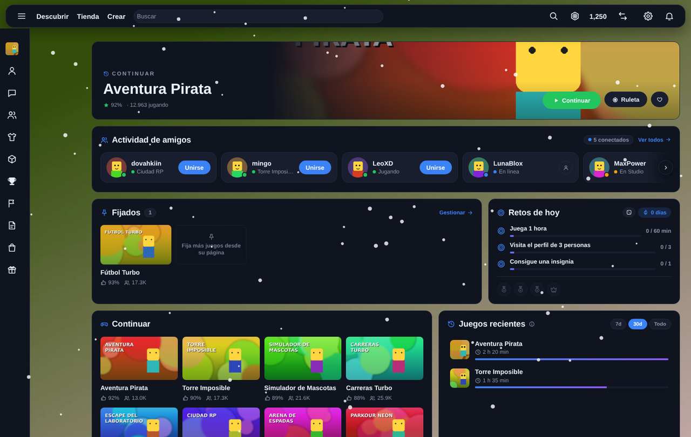 | 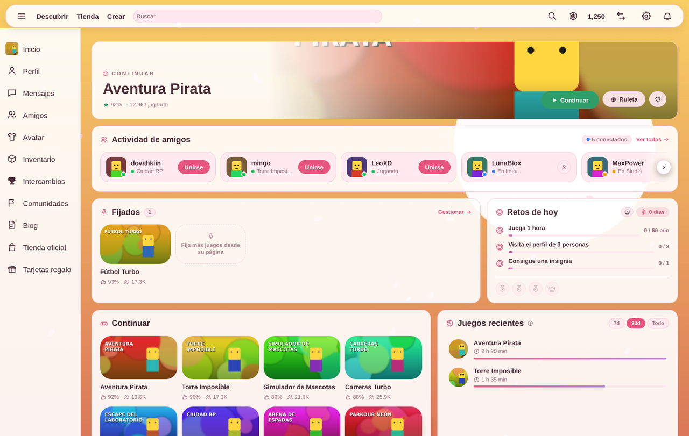 |
| Vídeo de tu PC de fondo, nieve y el menú lateral solo con iconos | Una imagen de tu PC de fondo con el tema Sakura |

**Iconos.** Más de cien iconos dibujados para RoCer0, sin emojis. Puedes cambiar su trazo, tamaño y color, y cambiar cualquiera (también los de la barra y el menú de Roblox) por una imagen de tu PC.

**Inicio.** Cambia el Inicio de Roblox por un panel de tarjetas que eliges y ordenas arrastrando: banner "Continuar" con el último juego, actividad de amigos con botón para unirte, juegos fijados, retos de hoy, continuar, juegos recientes con tu tiempo, recomendación destacada, recomendados y colecciones. Se colocan en mosaico, en dos columnas o una por fila, y cada tarjeta tiene sus opciones (cuántos amigos o juegos, el orden, el periodo de "recientes"…).

**Interfaz.** Usar todo el ancho de la pantalla, tarjetas de juego compactas, esconder partes de la web (chat flotante, botón de Robux, "Crear", campana, etiqueta de edad, pie de página) y entradas del menú lateral, y añadir tu propio CSS.

### Juegos

**Fijados.** Tus juegos a mano en el Inicio, el popup y PowerSearch, con carpetas y orden manual, por nombre o por los que jugaste hace menos. Se fija con un botón en la página de cada juego.

**Servidores.** Un panel en la página de cada juego para buscar servidores con filtros (huecos libres, ping, orden), ver la región de cada uno, copiar el enlace de un servidor para que un amigo entre en el mismo, ir a uno al azar, hacer server hop sin repetir los últimos y hacer auto-hop cada cierto tiempo.

**Insignias.** Una tabla compacta con la rareza de cada insignia del juego y las que ya tienes, con orden, columnas y la opción de esconder las conseguidas.

**Descubrir y ocultos.** Filtra las listas de juegos por valoración mínima o por palabras, oculta un juego o todos los de un creador con un botón, y quita los juegos patrocinados y los anuncios. Desde los ajustes puedes volver a mostrar lo que ocultaste.

### Personas

**Perfiles.** En el perfil de cada persona: valor de su inventario y sus objetos más valiosos (si es público), amigos en común, nombres anteriores y cuándo se conectó por última vez.

**Amigos.** Registra a qué juegan tus amigos para el Inicio, las estadísticas y el Wrapped, y te deja marcar amigos favoritos para los avisos.

**Notas.** Notas y etiquetas personales en juegos y perfiles, que solo ves tú. En los ajustes están todas juntas, con buscador y filtro por etiqueta.

**Cuentas.** Guarda tus cuentas de Roblox y cambia entre ellas con un clic desde la barra de Roblox, el popup o los ajustes.

### Catálogo y Robux

**Catálogo y avatar.** Vista previa rápida de cada objeto del catálogo (y probártelo), botones de herramientas en cada objeto (explorador, contenido, descarga y propietarios), valor y enlace de Rolimons en los limitados, equipar accesorios sin el límite del editor de avatar y un cambiador rápido de trajes en el popup.

**Lista de deseos.** Sigue el precio de los objetos que quieras y recibe un aviso cuando bajan, cuando llegan al precio que pusiste o cuando vuelven a estar a la venta.

**Intercambios.** Valor de Rolimons sobre cada objeto en tus intercambios, calculadora (descuenta el 30 % que se queda Roblox de los Robux que recibes) y avisos de los trades que te llegan, con lo que ganas o pierdes.

**Robux y dinero.** El precio en dinero real junto a los Robux, en cualquiera de 153 monedas o en una propia, con el precio de compra o el de DevEx, y el formato que prefieras.

### Tu actividad

**Retos.** De 1 a 5 retos al día de 12 tipos (jugar un rato, varios juegos, unirte a un amigo, visitar perfiles, probar un juego nuevo…), con tres dificultades, rachas, cuatro medallas y un calendario de las últimas semanas. Puedes cambiar los retos una vez al día.

**Wrapped.** El resumen de tu mes en Roblox: tiempo jugado, juegos, días, insignias, retos, con quién más jugaste y tus juegos del mes. Incluye una tarjeta para compartir en formato horizontal, cuadrado o de historia, con los colores de tu tema o los que elijas. Se descarga o se copia como imagen.

**Estadísticas.** Tu tiempo en roblox.com por día, un gráfico de tu saldo de Robux, tu tiempo en cada juego, a qué juegan tus amigos y su última conexión. Tú eliges qué se registra y qué periodo enseña cada gráfico.

**Descansos.** Un recordatorio para descansar tras un rato jugando y un límite de juego al día, con aviso del sistema y también dentro de roblox.com.

**Ruleta y confeti.** Una ruleta que elige a qué jugar entre tus fijados, tus recientes o los recomendados, y confeti cuando consigues una insignia, completas los retos, ganas una medalla o haces un buen trade.

### Herramientas

**PowerSearch.** Un buscador rápido de tus fijados, juegos, personas, objetos y grupos que se abre con `Ctrl+K` en cualquier página de Roblox, con botón para jugar y búsquedas recientes.

**Copiar IDs.** Botones para copiar el ID o el enlace de juegos, objetos, personas, grupos e insignias.

**Modo streamer.** Oculta tu nombre, tu avatar, tus Robux, los nombres de tus amigos y el chat mientras haces directo, con un atajo para encenderlo y apagarlo.

**FPS y ping.** Un contador de FPS de la web y del ping hacia Roblox, con posición, tamaño y colores a tu gusto.

**Detector de plugins.** Revisa los plugins y modelos de la tienda de creadores y avisa de señales típicas de malware, como `require()` ocultos, `getfenv` o `loadstring`.

### RoCer0

**Notificaciones.** Todos los avisos en un sitio: amigos que se conectan o entran a un juego (todos o solo los favoritos), insignias, y un horario de silencio.

**Popup.** El panel que se abre con el botón de RoCer0 en la barra del navegador: retos, tu partida y server hop, trajes, fijados, tema, interruptores rápidos, cuentas y accesos directos. Eliges qué tarjetas salen, en qué orden y su tamaño.

**General, permisos y datos.** Cómo se abren los ajustes, cada cuánto se consulta a Roblox, los permisos, la copia de seguridad y el borrado de lo que guarda RoCer0.

## Los ajustes

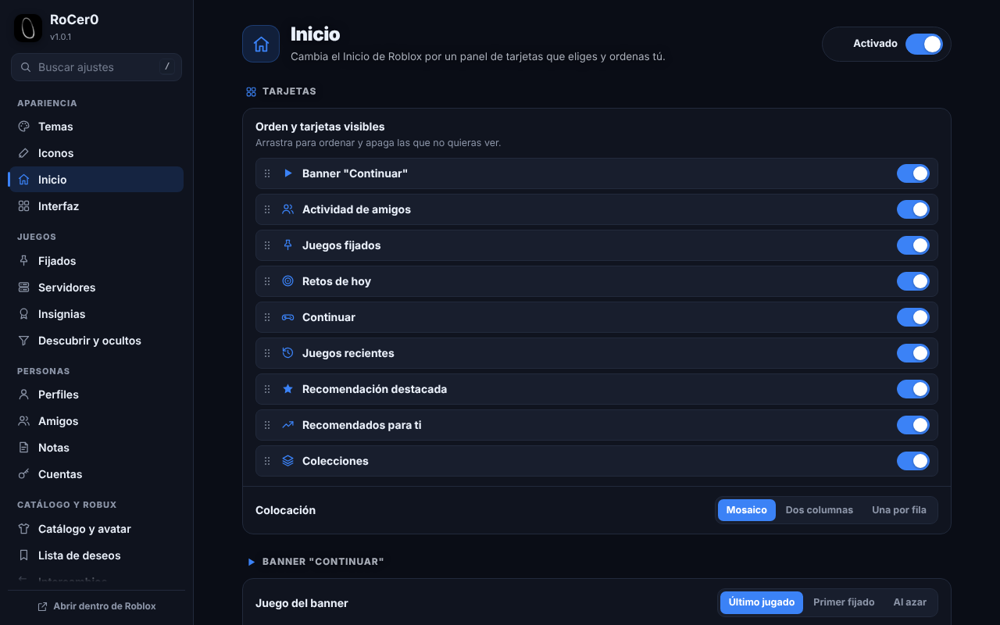

- Están **dentro de Roblox**: en roblox.com, ve a **Ajustes → RoCer0** o a la rueda dentada → **RoCer0**. También se abren como página aparte desde el popup.
- Un **menú lateral** con las 30 secciones, agrupadas como en este texto.
- Un **buscador** que encuentra cualquier opción por su nombre (pulsa `/`). Las opciones se pueden cambiar desde los propios resultados.
- Cada sección tiene un **interruptor general** arriba y un botón para **restablecerla**.
- Densidad cómoda o compacta, y abrir en la última sección que usaste o en la que elijas.

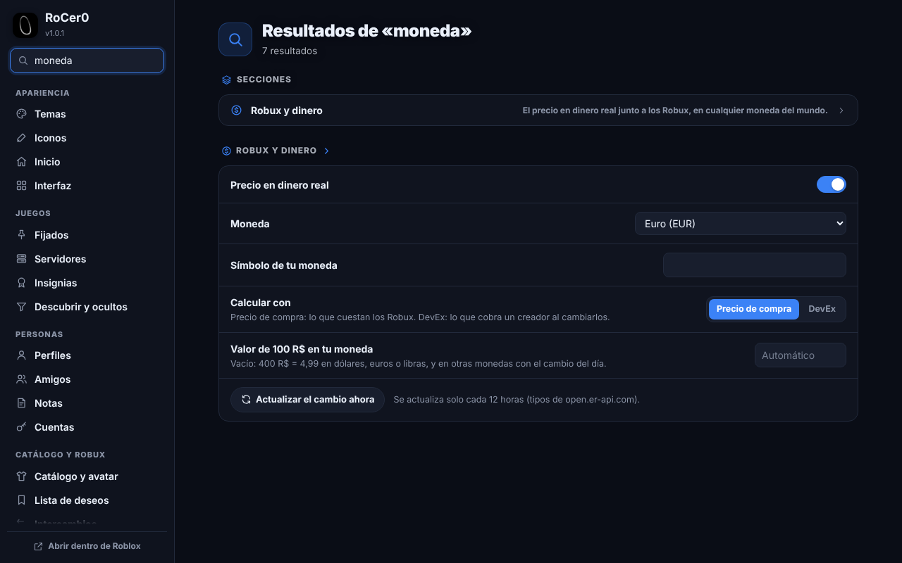

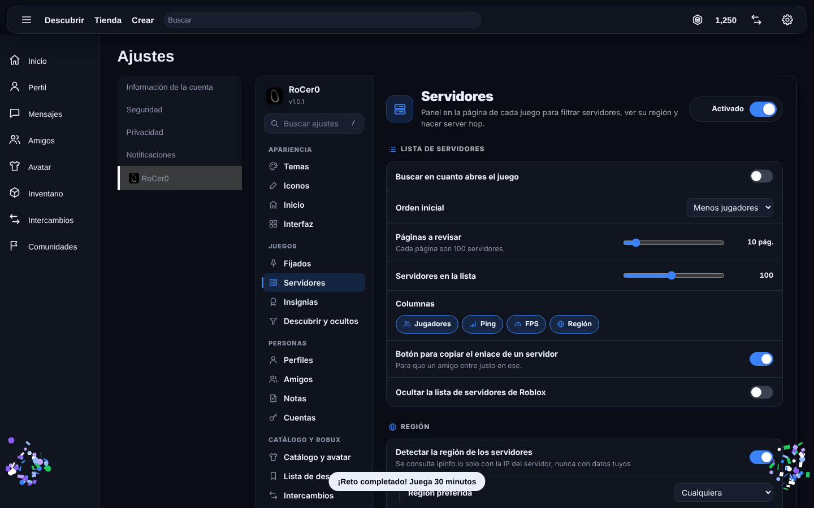

| | |
|---|---|
| 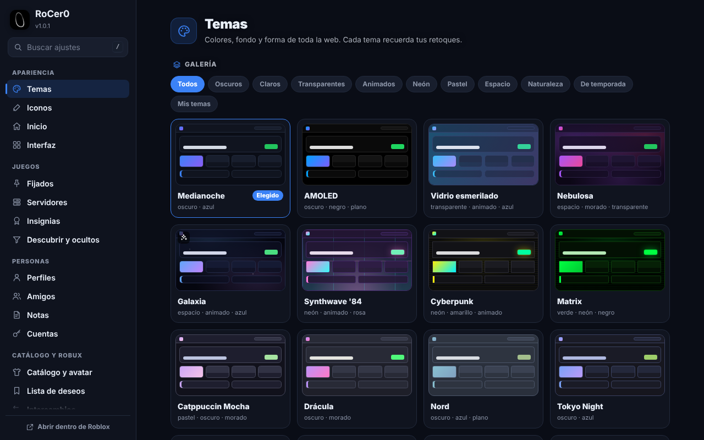 | 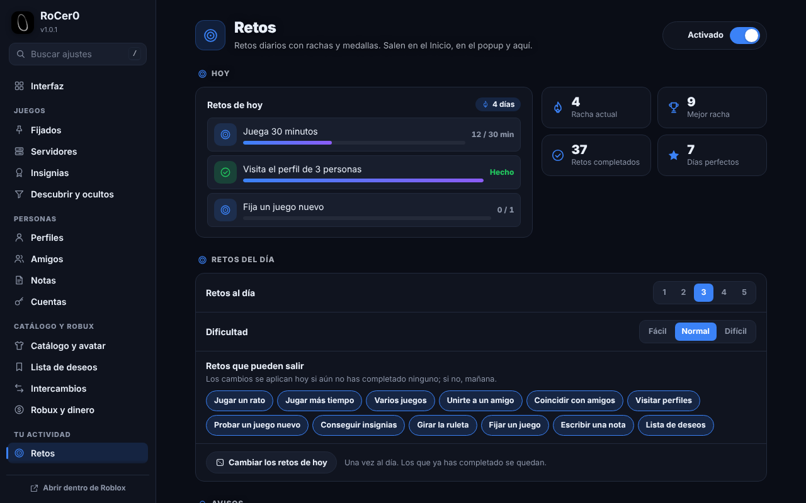 |
| 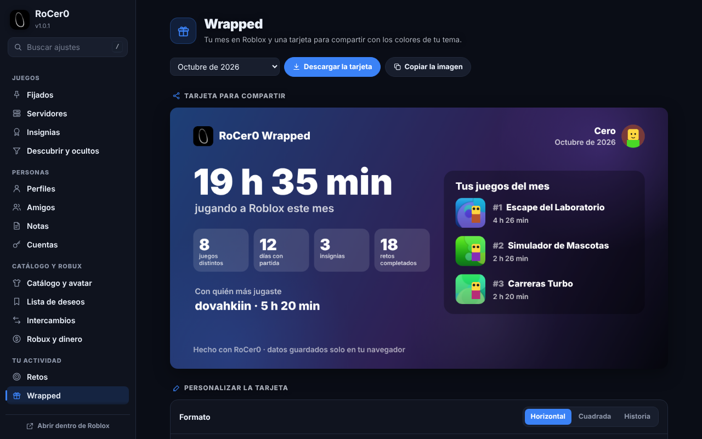 | 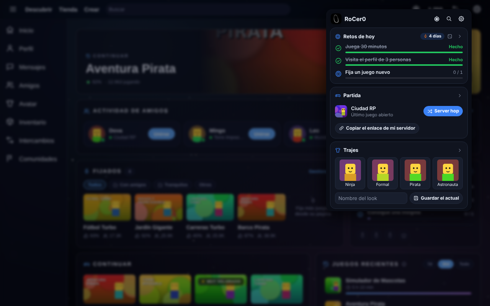 |

## Atajos de teclado

| Atajo | Qué hace |
|---|---|
| `Ctrl+K` | Abre PowerSearch en roblox.com (se puede cambiar) |
| `Alt+Shift+R` | Abre el popup de RoCer0 |
| `/` | Busca en los ajustes |
| El que elijas | Enciende y apaga el modo streamer |

## Privacidad y permisos

- RoCer0 **no tiene servidor propio** y no manda datos tuyos a nadie.
- Solo habla con:
  - **Roblox**, para todo lo que muestra;
  - **Rolimons**, para los valores de los objetos limitados;
  - **ipinfo.io**, solo con la IP de los servidores de juego, para saber su región (se puede apagar);
  - **open.er-api.com**, para los tipos de cambio de moneda.
- Las sesiones de las cuentas guardadas se quedan solo en el almacenamiento local de la extensión y solo se envían a roblox.com.
- Permisos que pide:
  - **almacenamiento**, para tus ajustes y datos;
  - **alarmas**, para las consultas periódicas;
  - **notificaciones**, para los avisos;
  - **cookies**, solo para cambiar de cuenta;
  - **acceso a esas cuatro webs**.

## Límites conocidos

- **Roblox cambia su web a menudo.** Si cambia algo, una función puede dejar de verse hasta que se actualice RoCer0.
- **Los FPS dentro del juego** los mide el cliente de Roblox (`Shift+F5`). RoCer0 muestra los FPS de la web y el ping hacia Roblox.
- **Server hop:** la extensión no puede cerrar el juego. Abre la entrada al servidor nuevo y Roblox cierra la partida anterior.
- **Región del servidor:** Roblox no la publica. Se calcula localizando la IP del servidor.
- **Última conexión:** Roblox ya no la enseña. RoCer0 la reconstruye con lo que ve desde que lo instalaste.
- **Estadísticas, Wrapped y retos** empiezan vacíos y se llenan mientras el navegador está abierto.
- **Vídeo de fondo:** hasta 30 MB, sin sonido y en bucle.

## Para desarrolladores

RoCer0 está hecha en JavaScript sin dependencias ni paso de compilación. El código está en [`extension/`](extension):

| Carpeta | Qué contiene |
|---|---|
| `manifest.json` | Manifest V3 que sirve para Firefox y para Chromium |
| `background.js` | Consultas periódicas, avisos, retos, cuentas y lista de deseos |
| `common/` | Ajustes por defecto y sus secciones (`defaults.js`), temas, iconos, fondos animados y confeti |
| `content/` | Lo que se añade a roblox.com: Inicio, temas, PowerSearch, servidores, perfiles, catálogo… |
| `options/` | La página de ajustes, que se genera a partir de las secciones de `defaults.js` |
| `popup/` | El panel del botón de la barra |
| `page/` | Piezas que se cargan dentro de Roblox (vídeo de fondo y lanzador de juegos) |

Para probarla sin empaquetar, carga la carpeta `extension/` como extensión descomprimida en Chromium o su `manifest.json` como complemento temporal en Firefox.

Para crear los dos zips (Firefox y Chromium) hace falta Node.js y el comando `zip`:

```sh
node herramientas/empaquetar.mjs extension dist
```

`content/layout.css`, la estructura que cambian los temas, se genera con Python a partir de las listas de selectores de `herramientas/estructura.py`:

```sh
python3 herramientas/estructura.py extension/content/layout.css
```

Los iconos de la extensión (`icons/icon-16.png` a `icon-128.png`) y el logo grande (`icons/logo.png`) salen del logo original, [`herramientas/logo-original.png`](herramientas/logo-original.png). Para rehacerlos hace falta Python con Pillow y NumPy:

```sh
python3 herramientas/logo.py herramientas/logo-original.png extension/icons
```
